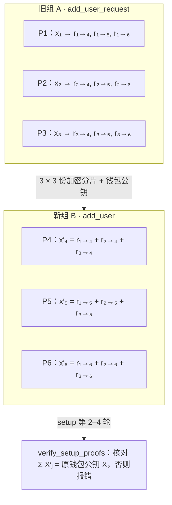

# CMP 三方 MPC 钱包演示 · 说明文档

2026-10-17

本文是 [`cmp-3party-wallet.html`](cmp-3party-wallet.html) 的使用与实现说明。开发过程中的详细测试记录见 [README.md](README.md)。

## 概述

这是一个单文件网页，演示由三方共管、任何一方都不掌握完整私钥的 MPC 钱包，能在三条测试网上做真实转账。三个参与方在同一个页面里各自运行 CMP 协议，所有密码学运算都是真实计算，不是模拟。

- **依据**：
  - 论文 Canetti 等，[UC Non-Interactive, Proactive, Distributed ECDSA with Identifiable Aborts](https://eprint.iacr.org/2021/060)（ePrint 2021/060，2024-10-21 版）；
  - 源码 [fireblocks/mpc-lib](https://github.com/fireblocks/mpc-lib) @ `00ae08b`。
- **能做什么**：
  - 三方生成私钥分片，组建同一个钱包；
  - 预签名、在线签名与非交互签名，以及三方 EdDSA；
  - 在以太坊 Sepolia、Solana Devnet、比特币 testnet4 上构建、签名并广播转账；
  - 为同一个钱包再分出一组三片私钥（add user）；
  - 用 GPG 加密备份与恢复私钥分片。
- **密钥**：一次密钥生成产出两把三方共管的密钥。secp256k1 密钥给以太坊和比特币用，Ed25519 密钥给 Solana 用。
- **两个版本**：
  - 本地版：仓库里的 `third-party/fireblocks/mpc-demo/cmp-3party-wallet.html`，下载后直接用浏览器打开，能联网查询和广播；
  - 在线版：[claude.ai 托管页面](https://claude.ai/artifact/NbWyg1EmQL6W6NoP1nCRo8)，私有链接，分享后别人才能打开。它无法访问外部网络，只能演示协议，不能查链上数据或广播。

页面界面是中文，只用于测试网。

## 快速开始

从打开页面到发出第一笔测试网转账，大约需要五步：

1. 下载 `cmp-3party-wallet.html`，用 Chrome、Edge、Firefox 或 Safari 的较新版本直接打开，不需要服务器。
2. 点顶部的「一键运行全部步骤」。页面会跑完密钥生成、一份预签名和一次签名，开启动画时约 30 秒；把「动画」设为「关闭」会快很多。
3. 打开「③ 链上转账」，复制以太坊、Solana 或比特币地址，到水龙头领测试币。
   - Sepolia：任意 Sepolia 水龙头；
   - Solana Devnet：页面上的「空投」按钮，或 Solana 官方水龙头；
   - 比特币 testnet4：页面上列了 mempool.space、faucet.testnet4.dev、coinfaucet.eu 三个水龙头。
4. 填收款地址和金额，点「构建交易并用 MPC 签名」。页面会展示交易字段、签名哈希和三方各自的签名份额。
5. 核对无误后点「广播交易」，页面会自动查询确认状态，并给出区块浏览器链接。

钱包会自动保存在本浏览器里，刷新不会丢。换浏览器或清理网站数据前，请先在「⑤ 密钥备份与恢复」里导出备份。

## 页面结构

顶部菜单把页面分成六页，前四页上方始终显示分片组切换栏和三方状态卡。

| 菜单页 | 内容 |
| --- | --- |
| ① 构建钱包 | 密钥生成 4 轮，得到钱包公钥和三个地址 |
| ② 签名 | 预签名 3 轮加输出、签名份额、合成与验签；可选在线或非交互模式，有预签名池 |
| ③ 链上转账 | 以太坊 Sepolia、Solana Devnet、比特币 testnet4 三个标签页 |
| ④ 新增分片组 | 为同一个钱包再分出一组三片私钥（5 步） |
| ⑤ 密钥备份与恢复 | GPG 加密导出与恢复、本地保存状态、JSON 导出与导入 |
| ⓘ 说明 | 已实现的部分、省略的部分、论文与源码的写法差异 |

**三方状态卡**显示当前分片组每一方的私钥分片、公钥分片、Paillier 模数、三个地址和可用预签名数。秘密值是红色，可以用工具栏的「显示秘密值」开关模糊。点击任何一个值，可以在完整十六进制和缩写之间切换。

**三节点动画**：每个步骤执行完后，先播放一段节点动画：

- 本地计算：节点高亮，逐个亮出生成的数据；
- 数据交换：标着内容的数据包沿弧线飞到对方，广播是一发两份，MtA 是点对点；
- 校验：节点上显示通过了几项校验；
- 共同输出：三方得到的公钥、R 或签名。

动画里的数据都压缩成小标签：秘密值带锁图标，收到的数据是虚线框。步骤完成后可以点「查看各节点数据」，展开这一步各方的完整数值、发出的消息和校验结果，也可以点「重播动画」。动画速度可以设为正常、快速或关闭；系统开启“减少动态效果”时默认关闭。

## 协议实现

CMP 是 3-of-3：钱包私钥 x = x₁ + x₂ + x₃，但协议里没有任何一方算出过 x，缺任何一方都签不出名。参数与 mpc-lib 一致：Paillier 2048 位，Ring-Pedersen 1024 位，MtA 掩码 β 取 32×5 字节。

**密钥生成**（论文 Fig.6 + Fig.7，`cmp_setup_service`）——每一轮同时为 secp256k1 和 Ed25519 两个 key_id 执行：

1. `generate_setup_commitments`：每方随机取 x<sub>i</sub>，生成 Schnorr 随机数 k、32 字节 seed、Paillier 密钥和 Ring-Pedersen 参数，对公开值做带盐 SHA-256 承诺，只广播承诺。
2. `store_setup_commitments`：收齐承诺后计算 ack = SHA256(Σ id ‖ commitment)，广播解承诺和 ack。
3. `generate_setup_proofs`：核对解承诺与 ack，srid = seed₁ ⊕ seed₂ ⊕ seed₃；生成 Schnorr 证明和 Ring-Pedersen 参数证明 Π<sup>prm</sup>（80 轮）。
4. `verify_setup_proofs`：验证另外两方的证明，得到钱包公钥 X = X₁ + X₂ + X₃。

**预签名**（论文 Fig.8）：

1. MtA 请求：每方取 k<sub>i</sub>、γ<sub>i</sub>，广播用自己 Paillier 公钥加密的 K<sub>i</sub>、G<sub>i</sub>，以及对 k<sub>i</sub> 的承诺 A、B、Z。
2. MtA 应答：对每个对方，在对方的密文上同态乘以自己的 γ<sub>i</sub> 和 x<sub>i</sub>，加上掩码 β，点对点发回。
3. 解密得到 α，累加出 δ<sub>i</sub>、χ<sub>i</sub>；广播 δ<sub>i</sub>、Δ<sub>i</sub> = k<sub>i</sub>·Γ 和离散对数证明。
4. 输出：检查 δ·G = ΣΔ<sub>j</sub>，计算 R = δ⁻¹·Γ = k⁻¹·G，各方保存 (k<sub>i</sub>, χ<sub>i</sub>, R)。

**签名与合成**：r = R.x mod n，每方的签名份额为

```
s_i = k_i · m + r · (k_i · x_i + χ_i)
```

三份相加得到 s = k(m + r·x)，就是一个标准 ECDSA 签名，最后规范成 low-s。

- **在线签名**（Fig.4，`cmp_ecdsa_online_signing_service`）：先确定消息，再连续跑 3 轮 MtA，第 4 轮直接出签名份额。
- **非交互签名**（Fig.5，`cmp_ecdsa_offline_signing_service`）：事先生成预签名存入池中，签名时只要 1 轮。按源码的 MPC_RAND_R_VERSION 用 h = SHA256(R ‖ X ‖ m) 把 R 再随机化；每份预签名用后即删。

**三方 EdDSA**（`eddsa_online_signing_service`，给 Solana 用）：

1. 每方取 k<sub>i</sub>，算 R<sub>i</sub> = k<sub>i</sub>·B，只广播承诺 SHA256(salt ‖ R<sub>i</sub>)。
2. 收齐承诺后公开 R<sub>i</sub>。
3. 核对解承诺，R = ΣR<sub>j</sub>，c = SHA512(R ‖ A ‖ M) mod ℓ，s<sub>i</sub> = c·x<sub>i</sub> + k<sub>i</sub>。
4. s = Σs<sub>j</sub>，签名为 R ‖ s，用标准 Ed25519 验签。

## 新增分片组（add user）

在当前分片组三片私钥都在的前提下，可以再分出一组新的三片私钥。新组与旧组对应同一个钱包公钥，三个地址都不变。



旧组每方把自己的分片拆成三份，分别加密给三个新成员；每个新成员把收到的三份相加，就是自己的新分片。

- **编号**：A 组是 P1–P3（密钥生成得到），B 组是 P4–P6，C 组是 P7–P9，最多 3 组。
- **key_id**：新组使用新的 key_id，B 组是 `demo-wallet-key-0003`（secp256k1）和 `demo-wallet-key-0004`（Ed25519）。
- **独立性**：任一组的三方都能单独签名，两组的分片不能混用；每组有自己的预签名池。
- **旧组仍然有效**：源码的 add_user 只为新 key_id 建立分片，不会删除旧 key；是否吊销旧组由上层业务决定。

流程按 mpc-lib 的 `cmp_setup_service::add_user_request`（旧成员）和 `add_user`（新成员）实现，分 5 步，两把密钥各做一遍：

1. **旧组拆分并加密**：旧组每方把 x<sub>i</sub> 拆成三份加法分片，前两份随机，最后一份 = x<sub>i</sub> − 前两份；每份用对应新成员的公钥加密，连同钱包公钥作为 `add_user_data` 发出，共 3 × 3 份密文。
2. **新成员解密并承诺**：核对三方发来的钱包公钥一致、都有给自己的那份；解密后相加得到新分片 x′<sub>j</sub>；生成自己的 Paillier 与 Ring-Pedersen 密钥，按新 key_id 做承诺。
3. **打开承诺**：新组三方之间的 setup 第 2 轮。
4. **发送零知识证明**：setup 第 3 轮，与密钥生成完全相同。
5. **验证并核对公钥**：add_user 路径在 metadata 里事先存了原钱包公钥，源码要求 Σ X′<sub>j</sub> 与它一致，否则报 INVALID_PARAMETERS。通过后新组加入钱包。

完成后，在页面上方的分片组栏切换签名使用的组，②签名和③链上转账都会改用这一组的三方。

源码里的 `platform_service::encrypt_for_player` 由平台实现，不规定算法。本演示用 secp256k1 ECIES 代替：密文是临时公钥 33 B ‖ 密文 32 B ‖ MAC 16 B，密钥流和 MAC 密钥由 SHA-256 派生。

## 链上转账

三条链都用 MPC 签名，签名过程同样有三节点动画。页面只在点击查询、空投、签名或广播时才请求所填的节点。

| 链 | 地址 | 交易格式 | 签名 | 默认节点 |
| --- | --- | --- | --- | --- |
| 以太坊 Sepolia | Keccak256(X)[12:]，EIP-55 校验和 | EIP-1559（类型 2），RLP 编码 | CMP，签 Keccak256(0x02 ‖ rlp(…)) | `https://ethereum-sepolia-rpc.publicnode.com` |
| Solana Devnet | base58(A) | legacy 消息，System Program Transfer | 三方 EdDSA，签整条消息 | `https://api.devnet.solana.com` |
| 比特币 testnet4 | P2WPKH `tb1q…`，与以太坊共用 secp256k1 公钥 | 隔离见证（BIP141） | CMP，每个输入的 BIP143 签名哈希各签一次 | `https://mempool.space/testnet4/api` |

**以太坊**：从节点取 chainId、nonce、base fee 和小费；小费至少 0.1 gwei，maxFee = 2 × base fee + 小费。签名后用 ecrecover 核对 `from` 就是钱包地址，广播后轮询回执。

**Solana**：取 recent blockhash，构建一条转账指令。blockhash 约 60–90 秒后失效，签名后要尽快广播。Devnet 上可以直接在页面上请求空投。

**比特币 testnet4**：

- UTXO 与费率：从 mempool.space 获取，也可以按 `txid:vout:金额(sat)` 每行一个手动填写；费率默认取“半小时内确认”那一档。
- 选币：从大到小选，多余金额找零回自己的地址；找零低于 294 sat 时并入手续费；交易默认允许 RBF。
- 收款地址：支持 `tb1q`、`tb1p`、`m`/`n`、`2` 开头的地址，主网地址会被拒绝。
- 签名：严格 DER（BIP66）加 low-s；用预签名池时每个输入消耗一份。
- 广播：POST `/tx` 后每 10 秒查询一次确认状态，testnet4 约 10 分钟出一个块。

三个节点都返回 `Access-Control-Allow-Origin: *`，所以从本地 `file://` 打开时能直接调用，页面上可以换成别的节点。所有网络请求都有 25 秒超时；在线版连不上网时，页面会给出可以复制到终端执行的 curl 广播命令。

## 保存、备份与恢复

钱包有三种保存方式，只有 GPG 备份是加密的。

| 方式 | 位置 | 内容 | 是否加密 |
| --- | --- | --- | --- |
| 本地自动保存 | 浏览器 localStorage，键 `cmp-mpc-demo-wallet-v1` | 所有分片组的分片和预签名池（格式 v2） | 否 |
| JSON 导出 / 导入 | ⑤ 页下方，复制粘贴 | 与本地保存相同 | 否 |
| GPG 加密备份 | ⑤ 页，下载 `.zip.asc` | 一个分片组的三份 JSON | 是，OpenPGP |

旧的 v1 格式（只有一组分片）和 v1 备份仍然能读取。“重新开始”要连点两次才会清除钱包，因为里面可能有测试币。

**GPG 加密导出**：

1. 选要备份的分片组，再选 GPG 公钥文件（`gpg --export --armor 你的邮箱 > pub.asc`），armor 和二进制格式都可以。
2. 每方存成一个 JSON，文件名按成员编号，例如 B 组是 `party-4.json`…`party-6.json`。每个文件只含这一方的秘密（两把密钥的 x<sub>i</sub>、Paillier 私钥、自己那份预签名），加上本组所有人的公开参数。
3. 三个 JSON 打成 `mpc-wallet-shares-组名-时间.zip`，用 OpenPGP.js 加密成 `.zip.asc`（SEIPD v1 + MDC）。GnuPG 可以直接解密：`gpg --output x.zip --decrypt x.zip.asc`。

浏览器只自动下载一次，之后再导出要点「点此下载」。在线版的下载白名单里没有 `.asc`，文件会存成 `.zip.asc.txt`，内容相同，gpg 照样能解密。

**解密恢复**：上传加密文件和 GPG 私钥（有口令就填口令），页面在本地解密、解压，对三份 JSON 逐项核对：

- 三份属于同一组的三个成员，与分片里记录的成员列表一致，地址一致；
- 每方 x<sub>i</sub>·G = X<sub>i</sub>、x<sub>i</sub>·B = X<sub>i</sub>，Paillier N = p·q；
- 每方的公钥分片与另外两方记录的一致；
- ΣX<sub>i</sub> 等于两把钱包公钥。

任何一项不通过，钱包都不会变。通过后，如果备份与当前钱包是同一把钥匙，只把这一组放回去（同名组被替换），其余分片组保留；否则替换整个钱包。页面也接受未加密的 zip。私钥和口令只在页面内存中使用，恢复后口令框会被清空。

## 安全边界与简化

这是教学演示，不是可以托管真实资产的钱包，只用于测试网。

**安全边界**：

- 三方运行在同一个浏览器页面里，消息直接在内存中传递，没有网络隔离和身份认证。谁拿到这个页面，就拿到了完整私钥。
- localStorage 和 JSON 导出里的分片是明文。
- Ed25519 公钥 A 由三方私钥标量直接相加得到，不是 RFC 8032 那样由种子派生，所以无法导出成普通 Solana 钱包的种子或助记词。链上只校验签名，不影响转账。

**为保持最小化而省略的部分**：

- Paillier-Blum 模数证明 Π<sup>mod</sup>（Fig.12）和 Paillier 大因子证明（Fig.26）。
- 预签名中的范围证明：k 的加密范围证明、γ 的指数证明、MtA 仿射运算证明 Π<sup>aff-g</sup>。
- HD 派生（派生增量为 0）、POSITIVE_R、密钥刷新，以及 mpc-lib 的备份与持久化格式。
- mpc-lib 的 asymmetric EdDSA（离线）变体；Solana 只用在线三轮签名。

**与源码的差异**：

- Ed25519 密钥的 setup 复用 secp256k1 那组 Paillier 与 Ring-Pedersen 参数；源码对每个 key_id 都重新生成。Π<sup>prm</sup> 仍按新的 aad 重新生成和验证。
- 新增分片组时，`encrypt_for_player` 用 secp256k1 ECIES 代替；新成员的加密密钥只在这一次流程中使用，没有平台身份登记。

**论文与源码的写法差异**（本演示按源码实现）：

- 论文 R = Γ，签名用 k̃ = k/δ；源码 R = δ⁻¹·Γ，签名直接用 k<sub>i</sub>。两者等价。
- 论文 D = enc(γk − β)、δ += β；源码 D = enc(γk + β)、δ −= β。符号相反，结果相同。
- 论文 Fig.10 逐个检查 σ<sub>j</sub>；源码只检查最终签名。本演示两种模式都验最终签名。

## 测试与验证

各部分都用独立实现做了交叉验证，但还没有用有余额的钱包在任何一条链上完成过真实转账。下表用到的库只装在测试环境里，页面本身不依赖它们。

| 部分 | 验证方式 | 结果 |
| --- | --- | --- |
| CMP 协议 | Node 跑 20 次签名（在线、离线交替） | 全部验签通过，ecrecover 恢复出钱包公钥 |
| Ed25519 | RFC 8032 向量 1；20 组随机签名交给 Node `crypto.verify` | 全部通过 |
| 以太坊 | ethers v6 解析 MPC 签出的原始交易 | `from` 等于钱包地址，哈希一致 |
| Solana | @solana/web3.js 构造同一条消息并 `verifySignatures()` | 消息字节相同，验签通过 |
| 比特币 | bitcoinjs-lib + @noble/curves：五种地址脚本、BIP143 哈希、txid / wtxid / vsize、严格 low-s 验签 | 全部一致 |
| 新增分片组 | 无头 Chrome 端到端：新增 B 组、切换签名、链上签名、备份恢复 | 155 项校验通过，地址不变；篡改公钥或密文会被拦下 |
| GPG 备份 | 用 PGPy 0.6 互通（RSA-3072 带口令、Ed25519 + Cv25519） | 双向可解密；篡改分片、错误口令或私钥都给出明确提示 |

**连接真实节点**：测试钱包没有余额，广播后三条链都返回了预期的拒绝，说明交易格式和签名被节点接受：

- Sepolia：`insufficient funds`；
- Solana：`Attempt to debit an account but found no record of a prior credit`；
- 比特币 testnet4：对模拟 UTXO 返回 `bad-txns-inputs-missingorspent`。

**界面**：无头 Chrome 中控制台没有报错；400–420 px 宽度下没有横向滚动；拦截所有外部请求后跑完全部流程，外部请求数为 0。

## 文件与构建

整个演示就是一个约 1 MB 的 HTML 文件，打开时不从外部拉取任何内容，脚本和字体都内嵌在文件里。

文件内依次是下面这些块：

| 块 | 全局名 | 内容 |
| --- | --- | --- |
| 字体 `<style>` | — | IBM Plex Mono / Sans / Sans Condensed 拉丁子集 woff2，SIL OFL 1.1 |
| 页面 `<style>` | — | 布局、浅色 / 深色主题、动画样式 |
| OpenPGP.js v5.11.2 | `openpgp` | 第三方库，原样内嵌，LGPL-3.0-or-later |
| JSZip v3.10.1 | `JSZip` | 第三方库，原样内嵌，MIT 或 GPL-3.0 |
| 基础工具 | `L` | BigInt 大数、secp256k1 与 Ed25519、SHA-256 / SHA-512 / Keccak-256 / RIPEMD-160、Paillier、Ring-Pedersen、零知识证明、base58 / bech32 / RLP |
| 协议引擎 | `PROTO` | 密钥生成、新增分片组、MtA 预签名、ECDSA 与 EdDSA 签名，一个函数对应 mpc-lib 的一个服务方法 |
| 链上编码 | `CHAIN` | EIP-1559、Solana 消息、比特币交易与选币、JSON-RPC 与 REST 请求 |
| 动画 | `ANIM` | 三节点（或两排六节点）动画引擎 |
| 页面逻辑 | — | 步骤状态机、分片组、保存与备份、三条链的转账界面 |

协议和链上部分的代码都是自己写的，只有 GPG 备份用到两个第三方库；页面注释里记下了它们的来源地址和 SHA-384。

仓库位置（[zlog-in/to-notes](https://github.com/zlog-in/to-notes)）：

- `third-party/fireblocks/mpc-demo/cmp-3party-wallet.html`：页面本身；
- `third-party/fireblocks/mpc-demo/guide.md`：本文；
- `third-party/fireblocks/mpc-demo/README.md`：中文说明与测试记录；
- `en/third-party/fireblocks/mpc-demo/`：英文版。

仓库里只提交了构建好的单文件，没有单独的源码模块和构建脚本。修改时可以直接编辑 HTML 里对应的 `<script>` 块。
